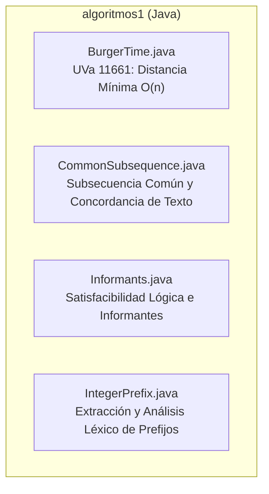

# Soluciones de Algoritmia y Programación Competitiva en Java

[](https://www.oracle.com/java/)
[](https://onlinejudge.org/)
[](LICENSE)

Colección de soluciones algorítmicas en **Java** para problemas clásicos de programación competitiva (plataformas como **UVa Online Judge** y jueces en línea). Incluye problemas de búsqueda lineal en una sola pasada $O(n)$, subsecuencias y cotejo de cadenas, resolución de paradojas lógicas (*Truth-Tellers vs Liars*) y análisis léxico de prefijos numéricos.

---

## 🧩 Problemas Resueltos en el Repositorio



---

### 1. Burger Time? (`BurgerTime.java`)

- **Contexto**: Problema clásico de **UVa Online Judge (Problem 11661: Burger Time?)**.
- **Descripción**: Dada una autopista lineal representada por una cadena de caracteres de longitud $L$, que contiene restaurantes (`R`), droguerías (`D`) y otros establecimientos (`.`):
  - Si un establecimiento es simultáneamente restaurante y droguería (`Z`), la distancia mínima es inmediatamente $0$.
  - En caso contrario, se debe encontrar la distancia euclidiana mínima entre cualquier par de `R` y `D`.
- **Complejidad Temporal**: **$O(L)$ en tiempo** y **$O(1)$ en espacio auxiliar**, resoluble en una sola pasada lineal actualizando los índices más recientes de `R` y `D`.

---

### 2. Common Subsequence (`CommonSubsequence.java`)

- **Descripción**: Cotejo y alineación de dos textos extensos para identificar el porcentaje de coincidencia y extraer subsecuencias y cadenas comunes compartidas.
- **Estrategia**: Comparación posicional y deslizamiento de ventanas para evaluar umbrales de correspondencia textual (*Fuzzy String Matching*).

---

### 3. Informants (`Informants.java`)

- **Descripción**: Problema de modelado lógico donde un conjunto de $A$ informantes emite $B$ testimonios sobre la inocencia o culpabilidad de otros participantes.
- **Estrategia**: Identificación de acusaciones cruzadas y contradicciones lógicas. Mantiene una lista de exclusión para aislar el número máximo consistente de informantes veraces (*Truth-Tellers vs Liars*).

---

### 4. Integer Prefix (`IntegerPrefix.java`)

- **Descripción**: Procesamiento y análisis sintáctico de flujos de texto para identificar, validar y aislar el prefijo numérico entero más largo que encabeza una cadena alfanumérica.
- **Estrategia**: Escaneo caracter a caracter hasta detectar el primer delimitador no numérico.

---

## 📂 Estructura del Proyecto

```text
algoritmos1/
├── src/
│   └── algoritmos/
│       ├── BurgerTime.java          # UVa 11661: Distancia minima en autopista lineal
│       ├── CommonSubsequence.java   # Comparacion y extraccion de subsecuencias comunes
│       ├── Informants.java          # Resolucion de paradojas logicas e informantes
│       └── IntegerPrefix.java       # Analisis lexico de prefijos numericos
├── build.xml                        # Script de compilacion Apache Ant
└── manifest.mf                      # Manifiesto de empaquetado JAR
```

---

## 🚀 Requisitos y Compilación

### Prerrequisitos

- **Java Development Kit (JDK)** versión 8 o superior.

### Compilación Manual con `javac`

```bash
# Compilar todas las clases dentro de src/
javac -d bin src/algoritmos/*.java
```

### Ejecutar un Problema (Ejemplo: `BurgerTime`)

```bash
java -cp bin algoritmos.BurgerTime
```

**Ejemplo de Entrada (Consola):**
```text
10
.R.....D..
0
```

**Salida Resultante:**
```text
6
```

---

## 📄 Licencia

Distribuido bajo la Licencia MIT. Consulta el archivo `LICENSE` para más información.
